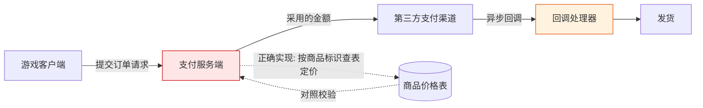

# 《二战风云2》支付链路安全研究

**授权红队演练案例 · 脱敏公开版**

| 项目 | 内容 |
|---|---|
| 研究对象 | 移动游戏《二战风云2》（JoyCrafter 发行） |
| 研究性质 | 授权红队演练 —— 支付业务链路安全评估 |
| 报告版本 | 脱敏公开版 v1.1 |
| 整理日期 | 2026-10-16（v1.0）· 2026-10-22（v1.1 复核） |
| 严重级汇总 | Critical × 1 · High × 3 · Medium × 2 · 待定 × 1 |

**v1.1 说明** —— 相对 v1.0 做了三类修订，逐条列在文末《附录 B》。最重要的一处：R-03 原作为「已确认的回调验签缺失」发布，复核后确认其样本存在混淆（全部为已支付订单），无法与「幂等分支」区分，已降级为**待定**。同时补入 v1.0 遗漏的 R-07（商品标识无有效性校验）。

---

## 合法性声明（本研究为什么可以公开）

**本研究在书面授权的红队演练框架内完成，可以合法公开，依据如下：**

1. **授权在案** —— 全部测试隶属于一次正式授权的红队演练，测试范围、边界与验证方式均在演练方案内事先声明并获批准；未进行任何超出授权范围的探测。
2. **仅使用自有测试资产** —— 所有操作均基于研究者自行注册的测试账号与测试角色，未接触、未读取、未影响任何真实玩家账号、订单与个人信息。
3. **资金验证边界清晰** —— 全程唯一一笔真实资金流动为 **0.01 元**，事前经授权方批准，目的仅为验证支付链路各环节的真实行为。除此之外未产生任何真实交易。
4. **无权限越界、无持久化** —— 全程未获取服务器权限、数据库权限或后台账号，未植入后门，未建立隧道，未导出任何业务数据。
5. **环境完好复原** —— 验证结束后，设备侧全部流量改写规则与采集进程均已移除，测试环境恢复原状。
6. **本报告为脱敏版** —— 已系统性剥离复现所需的全部技术要素（见文末《公开边界说明》）。**本文不含复现所需的任何技术要素。**

> **English summary** — Findings from an *authorized red-team engagement* against a mobile game payment pipeline. Testing used self-registered accounts under written authorization; one ¥0.01 real transaction was executed with prior approval purely to validate the pipeline end-to-end. No third-party data, server access or persistent access was obtained; the environment was fully restored. This public edition is redacted — target identifiers, request/response samples, parameter semantics and tooling were removed, so the findings **cannot be reproduced** from this document. Published for defensive and educational purposes only.

---

## 一、执行摘要

移动游戏支付链路是「客户端 → 支付服务端 → 第三方支付渠道 → 回调 → 发货」的多跳结构，每一跳都是一次**信任交接**。本研究系统评估了其中一条完整链路，核心缺陷为：**服务端把「金额」这一决定性字段的最终解释权留给了客户端。**

| 编号 | 发现 | 缺陷类别 | 严重级 |
|---|---|---|---|
| R-01 | 订单金额完全采用客户端提交值，服务端未按商品定价复算 | 服务端信任边界失效 | **Critical** |
| R-02 | 金额字段无取值校验：零值、负值与亚分金额均被接受并建单 | 输入校验缺失 | High |
| R-03 | 支付回调的校验边界未收敛（两组观测互相矛盾） | 认证缺失（待核） | **待定** |
| R-04 | 下单接口无鉴权，订单目标角色无归属校验 | 访问控制缺失 | High |
| R-05 | 支付与回调链路使用明文传输 | 传输安全 | Medium |
| R-06 | 同源代码的海外部署实例未纳入既有审计范围 | 攻击面管理 | Medium |
| R-07 | 商品标识无有效性校验：不存在的商品同样成单 | 输入校验缺失 | High |

**核心验证结论（R-01）**：以 **0.01 元**实际成交标价 **68 元**的商品档位，价差 **6800 倍**；服务端按商品标识对应的原价档位**全额发货** 1360 钻石（680 + 首充双倍 680），游戏内余额 12 → 1372 —— 缺陷贯穿下单、收款、发货**全链路**，而非单点参数污染。

---

## 二、研究背景与范围

- **对象**：一款运营中的移动端 SLG 游戏，支付体系由发行方自建支付中心承载，后端对接微信 / 支付宝等第三方渠道。
- **链路构成**：游戏客户端 → 支付下单接口（服务端按渠道创建第三方支付单）→ 第三方收银台 → 异步回调 → 发货。
- **演练授权范围**：互联网侧的支付业务链路；测试账号自有；验证性资金操作单笔、小额、事前批准。
- **未纳入**：第三方支付平台自身、其他玩家数据、服务器侧深度渗透 —— 缺陷完全存在于业务逻辑层，后者既无必要亦未开展。

图中两处着色即本次发现的两处信任断裂点：**定价环节**（R-01 / R-02）与**回调环节**（R-03）。

---

## 三、发现详情（脱敏）

### R-01 · 订单金额完全信任客户端 —— Critical

**问题本质**：下单请求中携带的应付金额字段，服务端**不做任何复核**即采用，直接以其向第三方支付渠道创建支付单。服务端未依据商品标识回查定价表 —— 金额的最终决定者是请求方。

**验证方式**：对同一商品标识，仅变更请求中的金额字段重放下单，观察服务端返回的支付单金额与第三方收银台实收金额。

**验证结果**：

- 服务端为第三方渠道创建的支付单金额，与请求中提交的金额**线性一致**（68.0 → 6800.00 分；0.01 → 1.00 分）；
- 第三方收银台实际展示金额随之变化，并完成一笔**真实收款**（¥0.01）；
- 支付完成后，服务端**按商品标识对应的原价档位全额发货**（68 元档 → 1360 钻石），未与实收金额比对。

**证据边界**：三项均为实测。但第三项只能证明**发货侧**不复核金额 —— 发货依据商品标识而非实收金额；**回调侧本身是否比对过金额，本轮没有单独观测**，因此「回调环节也不校验」属未验证外推，v1.1 不再这样表述。

**影响**：任意下单方可自行决定「付多少、买什么」。以 0.01 元成交标价 68 元档商品（价差 6800 倍）已在演练中端到端验证 —— 缺陷不局限于建单环节，而是贯穿**下单、收款、发货**全链。

---

### R-02 · 金额字段无取值校验 —— High

金额字段缺少最基本的合理性断言。服务端返回的支付金额恒等于传入值乘 100，下表五组边界全部建单成功：

| 传入金额 | 返回金额 | 建单结果 |
|---|---|---|
| 68.0 | 6800.00 | 成功，含真实支付凭据 |
| 0.01 | 1.00 | 成功，含真实支付凭据 |
| **0.001** | **0.10** | **成功，无支付凭据** |
| **0.0** | **0.00** | **成功，无支付凭据** |
| **-1.0** | **-100.00** | **成功，无支付凭据** |

零值、负值、以及低于最小计价单位（1 分）的 0.1 分金额，全部被原样接受并写入订单。表中 68.0 / 0.01 / 0.0 / -1.0 四行于 2026-10-20 重测并有落盘日志；0.001 一行来自初测。

**渠道差异（实测）**：微信渠道对零值 / 负值单不返回支付凭据；支付宝渠道则**仍以商户私钥签出完整支付串**（`total_amount` 分别为 `0.00` 与 `-1.00`，签名长度 831 / 825 字节）。支付宝侧收到零元单是否受理，**未验证**。

**结论**：缺少「金额必须为正整数、且不低于最小计价单位」的基础断言，属典型的服务端输入校验缺失。至于零元 / 负元订单能否推进到发货，取决于第三方渠道是否受理，本轮**未知**。

---

### R-03 · 支付回调的校验边界未收敛 —— 待定

回调端点同时接受两种请求形态：第三方平台的异步通知（表单体），以及内部验单调用（查询串 `orderId` + `verify_data`）。两条路径的观测结果不同，且**都没有把边界钉死**。

**路径一 · 表单体通知**

- 不带签名参数、`trade_status=TRADE_SUCCESS` 打一笔**已支付**订单 → `success`；
- 同一订单改为 `trade_status=TRADE_CLOSED` → `success`；
- 订单号不存在 → `failure`；
- 申报金额与订单金额数值不等（空值、`1`、`-0.01` 均被拒）→ `failure`；`0.010` 与 `0.01` 判为相等 → `success`，说明是数值比较而非字符串比较；
- 交易流水号缺失或凭空编造 → `success`。

**路径二 · 查询串验单**

- 对同一笔已支付订单连续 5 次请求 → **全部 `failure`**；
- 耗时 0.62 / 0.65 / 1.62 / 0.63 / 1.31 秒 —— 同一请求抖动近 2.6 倍，其中两次明显长于无参数基线（约 0.65 秒），说明处理器不是纯缓存短路。但**耗时长只证明「做了额外工作」，不证明「做了验签」**。

**为什么这两组结果不能互相解释**：路径一的样本**全部是已支付订单**。对一笔已完成的订单返回 `success`，既可能是「跳过验签」，也可能是「命中幂等分支直接返回成功」—— 这两种解释在现有数据下**无法区分**。要区分只需要一个样本：**一笔存在但未支付的订单，不带签名打过去**。v1.0 测试时选取的是手边唯一一笔真实成交订单，没有刻意构造未支付样本 —— 这是方法缺口，不是环境限制。

**当前结论：未知。** 两组观测都不足以支持「签名校验确定缺失」，也不足以支持「签名校验确定存在」。v1.0 曾把路径一的观测直接写成「完全跳过签名验证」，是把一组有混淆变量的样本当成了定论，v1.1 撤回。

**收敛所需的最小实验**：取一笔未支付订单，分三组打同一端点 —— 无签名 / 签名正确 / 签名错误，观察订单状态是否被推进到已支付并触发发货。三组结果才能把「是否验签」与「是否幂等」分离。

---

### R-04 · 下单接口无鉴权、目标角色无归属校验 —— High

- 下单接口**零认证**：无令牌、无 Cookie、无会话要求，请求可由任意客户端构造；
- **账号标识**仅做「账号表中是否存在」的查询，不要求任何身份凭证；
- **目标角色标识完全不校验**：凭空构造的 19 位角色 ID（该游戏实际使用的角色 ID 为 18 位）被直接接受，并原样写入订单的发货目标字段。

两者的校验差异是对照出来的：`user_id` 填不存在的账号 → 参数非法；`user_id` 填真实账号 + `role_id` 填上述构造值 → 建单成功。校验只发生在账号层，角色层没有任何校验。

**组合影响**：与 R-01 叠加后，形成「**以任意金额，为任意角色下单**」的能力 —— 请求发起者与被充值对象之间不需要存在任何关联。

**未跨越的边界**：该组合仅止于建单 —— 本轮**未付款、未发货**，因此「给非本人角色实际充值」这一步未被验证。

---

### R-05 · 支付链路明文传输 —— Medium

- 客户端实际使用的下单入口为**明文 HTTP**（同一应用另有 HTTPS 入口，但客户端不走向它）；
- 服务端在响应中下发的异步回调地址同样为**明文 HTTP**。

**影响**：金额字段与回调通知在传输层可被任意中间方读取与改写。本次演练中的端到端验证**正是经此路径完成** —— 无需服务端权限，也无需改动客户端逻辑（在设备侧改写明文请求即可）。这与第二节的「客户端结构分析」不矛盾：结构分析解决「哪个字段值得改」，链路改写解决「在哪里改」，是串行步骤而非替代关系。这同时说明：即便前端逻辑全部正确，链路层的完整性缺失也足以构成完整攻击面。

**附带观察（不属传输安全问题）**：支付宝渠道下发的回调地址在服务端拼串时未做 `trim`，尾部带 4 个空格。该缺陷影响回调地址的可用性，与传输层安全无关，此处仅作记录。

---

### R-06 · 同源代码的海外部署实例 —— Medium

海外站点与境内支付中心为**同一代码族的两套独立部署**（多组残缺请求的响应体逐字节一致，判定同源）。

- 既有资产底账将该实例记为「已测、零漏洞产出」，**该结论建立在错误的探测端口上**（把 80 端口的结果当成了全站结论，而支付路由在 443），其支付路由实际匿名可达；
- 该实例的下单服务当前返回「服务已关闭」，且对任意订单号的回调请求均为 `failure`，未出现任何可命中的订单 —— 暂不可作为独立目标；
- **推断（未验证）**：两侧若为同一套代码的部署，重新启用后 R-01 / R-02 / R-04 / R-07 应同构复现。依据是响应字节同构，不是对该实例的实际测试。

此发现的意义不在于「多一个目标」，而在于暴露了**资产测绘与审计覆盖的缺口**：同一代码族只审了一套部署。

---

### R-07 · 商品标识无有效性校验 —— High

下单请求中的商品标识**不与商品表比对**。以下取值全部返回建单成功：

| 商品标识 | 含义 | 结果 |
|---|---|---|
| 不存在的大数值 | 无此商品 | 建单成功 |
| 军官 / 赛季通行证 / 礼包 / 五星上将 等多个运营位 | 正常在售 | 建单成功 |

**意味着**：商品上下架状态、限购次数、活动时间窗口在这条路径上**全部不生效**。已下架或从未存在的商品都能生成订单并进入订单表。

**与 R-01 的区别**：R-01 改的是「付多少」，R-07 改的是「买什么」。两者同源 —— 建单环节只校验请求自身的自洽性（签名与它覆盖的几个字段匹配），不校验请求与业务配置的一致性。

**附带影响**：伪造的商品标识会产生无支付凭据的僵尸订单，污染订单表与后续对账。

---

## 四、修复建议

1. **金额服务端化（R-01，最高优先级）** —— 从协议中彻底移除客户端可提交的金额字段；服务端一律依据商品标识查表定价。对任何客户端传入的金额参数**一律忽略**，而非「校验后采用」。
2. **金额断言（R-02）** —— 强制金额为正整数且不低于最小计价单位；拒绝零值、负值、超范围值与非数值输入。
3. **回调验签（R-03，先测后改）** —— 在补任何代码之前，先用一笔**未支付**订单做三组对照（无签名 / 正确签名 / 错误签名），确认当前实现到底走哪条分支。若确认缺失，再使用第三方平台公钥验证签名，校验商户身份与订单归属；交易状态仅接受「支付成功」终态；金额自**第三方回执**读取，而非请求体自述。
4. **身份绑定（R-04）** —— 下单接口要求登录态；账号标识从会话推导而非请求提交；目标角色必须隶属于当前账号。
5. **回调幂等与状态机** —— 订单状态迁移加锁，记录已处理通知，防止重复发货。此项与 R-03 是否成立无关：无论验签是否缺失，缺幂等都是独立缺陷。
6. **全链路 HTTPS（R-05）** —— 下单入口与回调地址均启用 HTTPS 并校验证书。
7. **资产面补录（R-06）** —— 将同源代码的全部部署实例纳入同等审计范围；修正既有底账中的错误探测结论。
8. **商品标识校验（R-07）** —— 建单前校验商品存在于商品表、处于在售状态、在活动时间窗内且未超限购；不存在的商品标识直接拒单，不入订单表。

---

## 五、披露与处置状态

| 时间（UTC+8） | 事件 |
|---|---|
| 2026-09-28 | 授权演练启动；下单链路缺陷定位并验证（R-01） |
| 2026-09-29 06:26–06:34 | 端到端验证：经批准的 0.01 元真实支付完成，1360 钻石到账（R-01 闭环） |
| 2026-09-30 | 同批测试新增 R-02 / R-03 / R-04 / R-06；核心问题复核为未修复 |
| 2026-10-04 | 同批测试新增 R-07（商品标识无校验） |
| 2026-10-16 | v1.0 脱敏公开版整理发布 |
| 2026-10-19 至 10-20 | 复核：R-02 以落盘日志重测（零值 / 负值 / 亚分金额均建单）；R-03 未能复现原观测，降级为待定 |
| 2026-10-22 | v1.1 发布：撤回 R-03 的定论，补入 R-07，修正十三处表述 |

**最近一次复核（2026-10-20）结论**：R-01 / R-02 / R-04 复测仍可复现（价格与角色标识依旧不被校验）；R-03 未能复现原观测，状态改为待定；R-05 / R-06 / R-07 不在本轮复核范围内。

---

## 六、研究方法（概要）

本研究的方法论主线为**信任边界测绘**，而非工具堆叠：

1. **客户端结构分析** —— 识别客户端与支付服务端的交互结构与参数语义；
2. **运行时行为采集** —— 在受控测试账号上采集真实业务流量，还原请求 / 响应对；
3. **差分验证** —— 对决定性字段（金额、状态、归属）做单变量差分，区分「被校验」与「被信任」的字段；
4. **受控链路改写** —— 经授权对测试设备实施链路改写，验证从建单到发货的真实闭环；
5. **边界纪律** —— 每一步验证前明确「本步会改变什么状态」，单笔、小额、结束即停。**复原的对象是环境**（设备侧改写规则与采集进程），不包括业务侧产生的订单记录 —— 后者属测试账号的正常数据，保留不删。

**核心心法**：*客户端提交的每一个字段，都要先假设服务端不会校验它，再逐项证明或证伪。*

---

## 七、公开边界说明（有意省略的内容）

为防止未授权复刻，本公开版已移除全部复现要素：

- 全部主机标识（域名、IP、端口）与接口路径
- 请求 / 响应报文样本与字段命名
- 渠道编码、商品标识与价格档位映射
- 账号 / 角色 / 订单等一切实例标识
- 工具链配置、插桩脚本与流量采集方案
- 原始证据（抓包、截图、录屏）

**保留的内容**仅限：缺陷类别、根因描述、影响量级（如 6800 倍价差）、修复方向与披露时间线 —— 这些对防御方有全部价值，对攻击方**不提供任何可直接利用的信息**。

---

## 八、免责声明

本文档仅用于**安全研究、防御建设与教育目的**。

- 文中描述的问题类别（客户端可控金额、商品标识无校验、接口鉴权缺失、回调查询路径的校验边界）在各行业的真实系统中反复出现，本报告的防御价值独立于任何具体目标；
- **严禁**将本文所述思路用于任何未经书面授权的系统。在多数司法辖区，未授权访问计算机系统构成刑事犯罪；
- 本文不包含、也不构成任何可操作的攻击方法。读者若在自己的系统中复现类似问题，应遵循负责任的披露流程。

---

## 附录 A · 结论档位

每条结论按三档标注，同一条目内不混装：

| 编号 | 结论 | 档位 | 依据 |
|---|---|---|---|
| R-01 | 服务端采用客户端提交的金额建单 | **实测** | 改价请求返回金额线性变化；0.01 元真实支付完成 |
| R-01 | 发货按商品标识原价档位，不复核实收 | **实测** | 68 元档商品全额到账 1360 钻石 |
| R-01 | 回调环节本身是否比对过金额 | **未知** | 只观测到发货结果，未单独观测回调判据 |
| R-02 | 零值 / 负值 / 亚分金额被接受并建单 | **实测** | 2026-10-20 重测四组（有落盘日志）+ 初测一组 |
| R-02 | 零元 / 负元订单能否推进到发货 | **未知** | 取决于第三方渠道是否受理，未验证 |
| R-03 | 回调是否校验第三方签名 | **未知** | 两组观测矛盾，样本无法分离「跳过验签」与「命中幂等」 |
| R-04 | 下单接口无身份认证 | **实测** | 无令牌 / Cookie / 会话要求，请求可由任意客户端构造 |
| R-04 | 角色标识不被校验 | **实测** | 构造的 19 位标识建单成功 |
| R-04 | 可为非本人角色实际充值 | **未知** | 未付款、未发货 |
| R-05 | 下单与回调走明文 HTTP | **实测** | 客户端入口与下发的回调地址均为 `http://` |
| R-06 | 海外实例与境内实例代码同构 | **实测** | 10 组残缺请求 + 4 组探测用例响应逐字节一致 |
| R-06 | 重新启用后前述缺陷会复现 | **推断（未验证）** | 依据代码同构外推，未在该实例上测试 |
| R-07 | 商品标识不与商品表比对 | **实测** | 不存在的商品标识建单成功 |

---

## 附录 B · v1.1 相对 v1.0 的校正点

| # | 位置 | v1.0 | v1.1 | 依据 |
|---|---|---|---|---|
| 1 | R-03 标题与结论 | 「支付回调不验证第三方签名」，High | 「校验边界未收敛」，待定 | 样本全为已支付订单，无法区分跳过验签与命中幂等；复核时未复现同样响应 |
| 2 | R-03 影响段 | 「即可伪造通知把订单置为已支付」 | 删除，改为收敛所需的最小实验设计 | 未观测到订单状态被伪造通知推进 |
| 3 | 发现表 | 6 项 | 7 项（补 R-07） | v1.0 遗漏了同批测试中商品标识无校验的实测结果 |
| 4 | R-01 验证结果 | 「回调与发货环节均无金额复核」 | 拆为「发货侧不复核金额（实测）」+「回调侧未知」 | 只观测了发货结果，回调判据未单独观测 |
| 5 | R-02 表格 | 零值 / 负值「未能完成第三方建单」 | 分渠道：微信不返回凭据，支付宝仍签出支付串 | 2026-10-20 重测 |
| 6 | R-02 影响 | 「免费甚至反向获利的通道」 | 删除 | 「反向获利」需退款路径，无证据 |
| 7 | R-06 | 「订单库为空」 | 「对任意订单号的回调均返回 failure」 | 订单库是内部状态，外部只能观测到回调结果 |
| 8 | R-06 | 「R-01 ~ R-04 将同构复现」 | 改为推断，并去掉已降级的 R-03 | 未在该实例上测试 |
| 9 | 披露时间线 | 「9-30 补充确认 R-02 / R-03 / R-04」 | 「9-30 新增」，并补 10-04 与 10-19/20 两行 | 三项均为 9-30 当批新发现，不是复核确认 |
| 10 | 研究方法第 5 条 | 「事后复原」 | 「结束即停」，并说明复原对象是环境不是业务记录 | 业务侧订单记录保留，不属可复原范围 |
| 11 | 合法性声明第 6 条 | 「任何读者都无法依据本文复现」 | 「本文不含复现所需的任何技术要素」 | 前者断言读者能力，后者断言文档内容 |
| 12 | R-05 | 尾随空格缺陷列入传输安全 | 移为附带观察 | 属可用性缺陷，与传输层安全无关 |
| 13 | R-05 影响段 | 「无需破解客户端」 | 说明结构分析与链路改写的分工 | 原表述与第二节方法论表面冲突 |

---

## 许可

本作品采用 **CC BY-NC-SA 4.0** 许可协议 —— 允许署名、非商业性分享与演绎，演绎作品须以相同方式共享。

本报告基于授权演练脱敏整理；引用时请注明出处。
