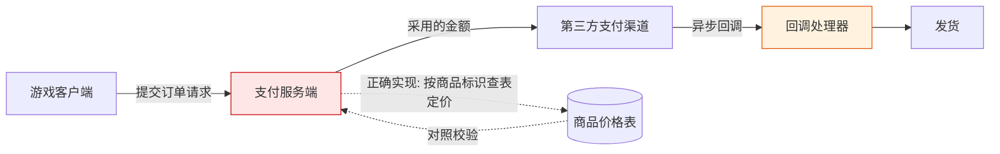

# 《二战风云2》支付链路安全研究

**授权红队演练案例 · 脱敏公开版**

| | |
|---|---|
| 研究对象 | 移动游戏《二战风云2》（JoyCrafter 发行） |
| 研究性质 | 授权红队演练 —— 支付业务链路安全评估 |
| 报告版本 | 脱敏公开版 v1.0 |
| 整理日期 | 2026-10-16 |
| 严重级汇总 | Critical × 1 · High × 3 · Medium × 2 |

---

## 合法性声明（本研究为什么可以公开）

**本研究在书面授权的红队演练框架内完成，可以合法公开，依据如下：**

1. **授权在案** —— 全部测试隶属于一次正式授权的红队演练，测试范围、边界与验证方式均在演练方案内事先声明并获批准；未进行任何超出授权范围的探测。
2. **仅使用自有测试资产** —— 所有操作均基于研究者自行注册的测试账号与测试角色，未接触、未读取、未影响任何真实玩家账号、订单与个人信息。
3. **资金验证边界清晰** —— 全程唯一一笔真实资金流动为 **0.01 元**，事前经授权方批准，目的仅为验证支付链路各环节的真实行为。除此之外未产生任何真实交易。
4. **无权限越界、无持久化** —— 全程未获取服务器权限、数据库权限或后台账号，未植入后门，未建立隧道，未导出任何业务数据。
5. **环境完好复原** —— 验证结束后，设备侧全部流量改写规则与采集进程均已移除，测试环境恢复原状。
6. **本报告为脱敏版** —— 已系统性剥离复现所需的全部技术要素（见文末《公开边界说明》）。**任何读者都无法依据本文复现该缺陷。**

> **English summary** — Findings from an *authorized red-team engagement* against a mobile game payment pipeline. Testing used self-registered accounts under written authorization; one ¥0.01 real transaction was executed with prior approval purely to validate the pipeline end-to-end. No third-party data, server access or persistent access was obtained; the environment was fully restored. This public edition is redacted — target identifiers, request/response samples, parameter semantics and tooling were removed, so the findings **cannot be reproduced** from this document. Published for defensive and educational purposes only.

---

## 一、执行摘要

移动游戏支付链路是「客户端 → 支付服务端 → 第三方支付渠道 → 回调 → 发货」的多跳结构，每一跳都是一次**信任交接**。本研究系统评估了其中一条完整链路，核心缺陷为：**服务端把「金额」这一决定性字段的最终解释权留给了客户端。**

| 编号 | 发现 | 缺陷类别 | 严重级 |
|---|---|---|---|
| R-01 | 订单金额完全采用客户端提交值，服务端未按商品定价复算 | 服务端信任边界失效 | **Critical** |
| R-02 | 金额字段无取值校验：零值与负值均被接受并建单 | 输入校验缺失 | High |
| R-03 | 支付回调处理未验证第三方签名 | 认证缺失 | High |
| R-04 | 下单接口无鉴权，订单目标角色无归属校验 | 访问控制缺失 | High |
| R-05 | 支付与回调链路使用明文传输 | 传输安全 | Medium |
| R-06 | 同源代码的海外部署实例未纳入既有审计范围 | 攻击面管理 | Medium |

**核心验证结论（R-01）**：以 **0.01 元**实际成交标价 **68 元**的商品档位，价差 **6800 倍**，且服务端按原价档位**全额发货** —— 证明缺陷贯穿下单、收款、回调、发货**全链路**，而非单点参数污染。

---

## 二、研究背景与范围

- **对象**：一款运营中的移动端 SLG 游戏，支付体系由发行方自建支付中心承载，后端对接微信 / 支付宝等第三方渠道。
- **链路构成**：游戏客户端 → 支付下单接口（服务端按渠道创建第三方支付单）→ 第三方收银台 → 异步回调 → 发货。
- **演练授权范围**：互联网侧的支付业务链路；测试账号自有；验证性资金操作单笔、小额、事前批准。
- **未纳入**：第三方支付平台自身、其他玩家数据、服务器侧深度渗透 —— 缺陷完全存在于业务逻辑层，后者既无必要亦未开展。

图中两处着色即本次发现的两处信任断裂点：**定价环节**（R-01 / R-02）与**回调环节**（R-03）。

---

## 三、发现详情（脱敏）

### R-01 · 订单金额完全信任客户端 —— Critical

**问题本质**：下单请求中携带的应付金额字段，服务端**不做任何复核**即采用，直接以其向第三方支付渠道创建支付单。服务端未依据商品标识回查定价表 —— 金额的最终决定者是请求方。

**验证方式**：对同一商品标识，仅变更请求中的金额字段重放下单，观察服务端返回的支付单金额与第三方收银台实收金额。

**验证结果（两端一致）**：

- 服务端为第三方渠道创建的支付单金额，与请求中提交的金额**线性一致**；
- 第三方收银台实际展示金额随之变化，并成功**真实收款**；
- 支付完成后，服务端**按商品原价档位全额发货**，回调与发货环节均无金额复核。

**影响**：任意下单方可自行决定「付多少、买什么」。以 0.01 元成交标价 68 元档商品（价差 6800 倍）已在演练中端到端验证 —— 缺陷不局限于建单环节，而是贯穿**下单、收款、回调、发货**全链。

---

### R-02 · 金额字段无取值校验 —— High

金额字段缺少最基本的合理性断言：

| 输入 | 服务端行为 |
|---|---|
| 正常价 | 正常建单 |
| 远低于正常价 | 正常建单 |
| **零值** | **接受，订单落库** |
| **负值** | **接受，订单落库** |

金额为零或负数时订单仍被建立并进入订单表。当前实例中此类订单未能完成第三方建单，但**订单已存在于业务系统**；一旦与任何「按订单金额发货」的分支逻辑耦合，即构成免费甚至反向获利的通道。

**结论**：缺少「金额必须为正整数、且不低于最小计价单位」的基础断言，属典型的服务端输入校验缺失。

---

### R-03 · 支付回调不验证第三方签名 —— High

异步回调处理器（负责将订单置为已支付并触发发货）**未校验第三方签名**。

**验证方式**：对回调端点构造**不含签名参数**的通知，差分测试各类字段组合下处理器的接受与拒绝边界。

**验证结果**：处理器的实际校验面**仅包含**两项 —— 订单号在库中存在、申报金额与订单金额数值相等。以下均**未被校验**：

- 签名（完全缺失）；
- 交易状态字段（已关闭状态的订单、重复通知同样被接受）；
- 交易流水号（可缺失或凭空构造）。

**影响**：任何能够访问回调端点者，只需知晓一笔**已存在且未完成**的订单号与其金额，即可伪造通知把订单置为已支付 —— 无需持有任何密钥、无需真实付款。当前该渠道处于摘除状态、无法新建可攻击订单，构成实际利用的前置限制；**但一旦渠道恢复或存在历史未支付订单，此路径即刻可用。**

---

### R-04 · 下单接口无鉴权、目标角色无归属校验 —— High

- 下单接口**零认证**：无令牌、无 Cookie、无会话要求，请求可由任意客户端构造；
- **账号标识**仅做「账号表中是否存在」的查询，不要求任何身份凭证；
- **目标角色标识完全不校验**：凭空构造的长位角色 ID 被直接接受并写入订单的发货目标。

**组合影响**：与 R-01 叠加后，形成「**以任意金额，为任意角色下单**」的能力 —— 请求发起者与被充值对象之间不需要存在任何关联。

---

### R-05 · 支付链路明文传输 —— Medium

- 客户端实际使用的下单入口为**明文 HTTP**；
- 服务端在响应中下发的异步回调地址同样为**明文 HTTP**（且存在尾随空格的拼串缺陷）。

**影响**：金额字段与回调通知在传输层可被任意中间方读取与改写。本次演练中的链路改写验证**正是经此路径完成** —— 无需破解客户端、无需服务端权限。这同时说明：即便前端逻辑全部正确，链路层的完整性缺失也足以构成完整攻击面。

---

### R-06 · 同源代码的海外部署实例 —— Medium

海外站点与境内支付中心为**同一代码族的两套独立部署**（多组残缺请求的响应体逐字节一致，判定同源）。

- 既有资产底账将该实例记为「已测、零漏洞产出」，**该结论建立在错误的探测端口上**，其支付路由实际匿名可达；
- 该实例的下单服务当前处于主动关闭状态、订单库为空，暂不可作为独立目标；
- **但一旦重新启用，R-01 ~ R-04 将同构复现。**

此发现的意义不在于「多一个目标」，而在于暴露了**资产测绘与审计覆盖的缺口**：同一代码族只审了一套部署。

---

## 四、修复建议

1. **金额服务端化（R-01，最高优先级）** —— 从协议中彻底移除客户端可提交的金额字段；服务端一律依据商品标识查表定价。对任何客户端传入的金额参数**一律忽略**，而非「校验后采用」。
2. **金额断言（R-02）** —— 强制金额为正整数且不低于最小计价单位；拒绝零值、负值、超范围值与非数值输入。
3. **回调验签（R-03）** —— 使用第三方平台公钥验证签名，校验商户身份与订单归属；交易状态仅接受「支付成功」终态；金额自**第三方回执**读取，而非请求体自述。
4. **身份绑定（R-04）** —— 下单接口要求登录态；账号标识从会话推导而非请求提交；目标角色必须隶属于当前账号。
5. **回调幂等与状态机（R-03）** —— 订单状态迁移加锁，记录已处理通知，防止重复发货。
6. **全链路 HTTPS（R-05）** —— 下单入口与回调地址均启用 HTTPS 并校验证书。
7. **资产面补录（R-06）** —— 将同源代码的全部部署实例纳入同等审计范围；修正既有底账中的错误探测结论。

---

## 五、披露与处置状态

| 时间（UTC+8） | 事件 |
|---|---|
| 2026-09-28 | 授权演练启动；下单链路缺陷定位并验证 |
| 2026-09-29 06:26–06:34 | 端到端验证：经批准的 0.01 元真实支付完成，确认回调与发货环节同样无金额校验 |
| 2026-09-30 | 同族面复核：核心问题尚未修复；补充确认 R-02 / R-03 / R-04 |
| 2026-10-16 | 本脱敏公开版整理发布 |

**最近一次复核（2026-09-30）结论**：R-01 未修复。

---

## 六、研究方法（概要）

本研究的方法论主线为**信任边界测绘**，而非工具堆叠：

1. **客户端结构分析** —— 识别客户端与支付服务端的交互结构与参数语义；
2. **运行时行为采集** —— 在受控测试账号上采集真实业务流量，还原请求 / 响应对；
3. **差分验证** —— 对决定性字段（金额、状态、归属）做单变量差分，区分「被校验」与「被信任」的字段；
4. **受控链路改写** —— 经授权对测试设备实施链路改写，验证从建单到发货的真实闭环；
5. **边界纪律** —— 每一步验证前明确「本步会改变什么状态」，单笔、小额、事后复原。

**核心心法**：*客户端提交的每一个字段，都要先假设服务端不会校验它，再逐项证明或证伪。*

---

## 七、公开边界说明（有意省略的内容）

为防止未授权复刻，本公开版已移除全部复现要素：

- 全部主机标识（域名、IP、端口）与接口路径
- 请求 / 响应报文样本与字段命名
- 渠道编码、商品标识与价格档位映射
- 账号 / 角色 / 订单等一切实例标识
- 工具链配置、插桩脚本与流量采集方案
- 原始证据（抓包、截图、录屏）

**保留的内容**仅限：缺陷类别、根因描述、影响量级（如 6800 倍价差）、修复方向与披露时间线 —— 这些对防御方有全部价值，对攻击方**不提供任何可直接利用的信息**。

---

## 八、免责声明

本文档仅用于**安全研究、防御建设与教育目的**。

- 文中描述的问题类别（客户端可控金额、回调验签缺失、接口鉴权缺失）在各行业的真实系统中反复出现，本报告的防御价值独立于任何具体目标；
- **严禁**将本文所述思路用于任何未经书面授权的系统。在多数司法辖区，未授权访问计算机系统构成刑事犯罪；
- 本文不包含、也不构成任何可操作的攻击方法。读者若在自己的系统中复现类似问题，应遵循负责任的披露流程。

---

## 许可

本作品采用 **CC BY-NC-SA 4.0** 许可协议 —— 允许署名、非商业性分享与演绎，演绎作品须以相同方式共享。

本报告基于授权演练脱敏整理；引用时请注明出处。
